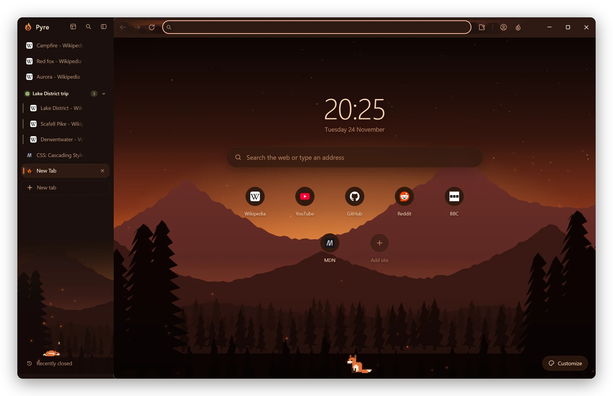
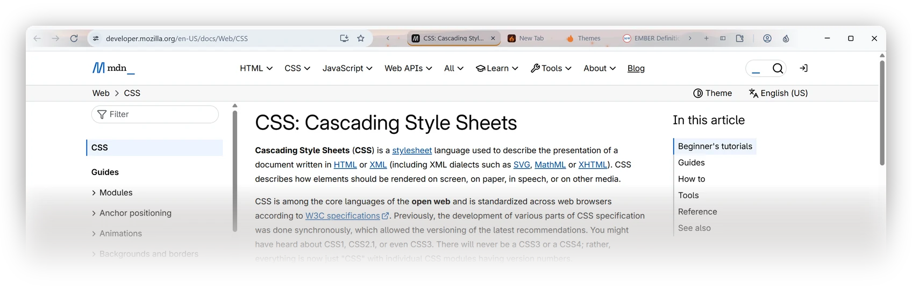
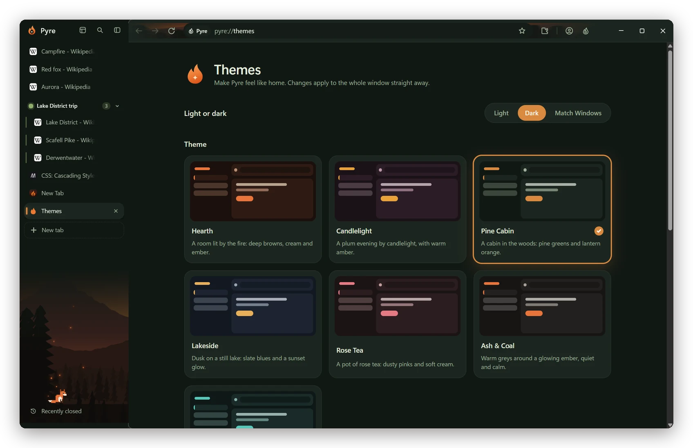
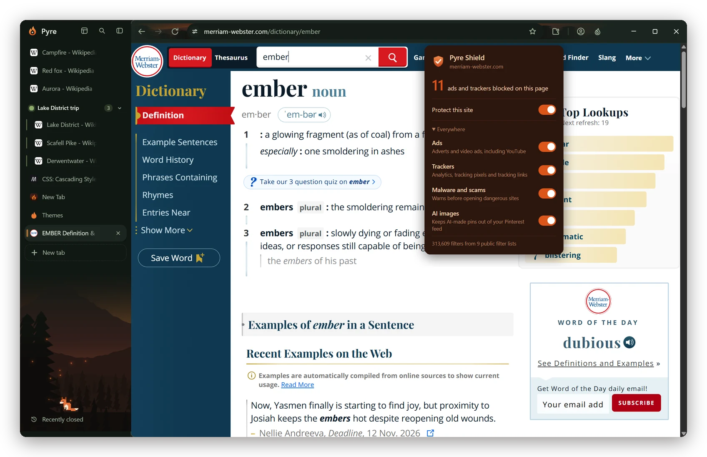
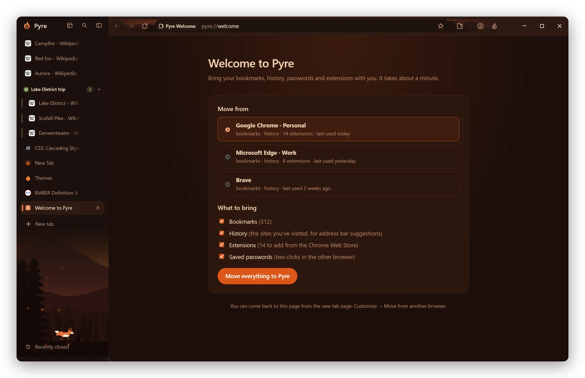

  

  

  
  
  
  

<h3 align="center">The browser you'll actually look forward to opening.</h3>

Every website and Chrome extension you rely on, wrapped in a warm, beautiful home that's all its own. 
Ads and trackers blocked from the first click. Not a single AI feature, anywhere. Free.

  

## Why people switch to Pyre

<table>
<tr>
<td width="33%" valign="top">
<b>It's gorgeous</b> 
A forest at dusk on every new tab, embers rising up the window, and six hand-tuned themes. Browsing stops feeling like work.
</td>
<td width="33%" valign="top">
<b>Ads are gone</b> 
Pyre Shield is built in and on from the start. It blocks ads (YouTube's too), trackers and scam sites, with nothing to install.
</td>
<td width="33%" valign="top">
<b>Zero AI</b> 
No assistant, no "help me write", no AI summaries, no AI model downloaded behind your back. Just a browser.
</td>
</tr>
<tr>
<td valign="top">
<b>Everything still works</b> 
Built on Chromium, the engine inside Chrome. Your favourite sites and your Chrome extensions all work exactly as before.
</td>
<td valign="top">
<b>Lighter on your PC</b> 
Tuned to use about a fifth less memory than Chromium's defaults, with updates that are usually just a few megabytes.
</td>
<td valign="top">
<b>Moves in with you</b> 
Bring your bookmarks, history, passwords and extensions from Chrome, Edge, Brave, Opera or Vivaldi in about a minute.
</td>
</tr>
</table>

## A browser that feels like home

Most browsers look like a filing cabinet. Pyre was designed to feel like a cabin you want to spend time in.

- **Tabs down the side, with room to breathe.** Your tabs sit in a sidebar where you can read their whole names, instead of squeezing into slivers along the top. Need more room? Fold it to a neat column of icons.
- **Shelves that tame tab chaos.** Gather a project or a holiday's worth of tabs onto its own shelf, say "Lake District trip". Give it a colour, and fold it away until you need it. Just drag a tab onto a shelf to add it.
- **A new tab page you'll love seeing.** A forest at dusk, a clock, a search box and your favourite sites, with embers rising from a campfire just out of sight. The same scene glows softly behind your tabs.
- **Delightful little details.** New tabs slide in with a glow. The current tab's ember flickers. The menu button is a flame that kindles when you open it. If you prefer stillness, it all calms down with Windows' reduce-motion setting.
- **Closed a tab by mistake?** It's waiting at the foot of the sidebar, one click from coming back.

### Prefer a clean, minimal look? One switch.

Turn on the **Hearth bar** and the sidebar tucks away completely. Your tabs become sleek chips sitting right beside the address bar, in one slim row, so the page gets almost the whole window. Got lots of tabs? Scroll through them with the arrows or your mouse wheel.

  

## Make it unmistakably yours

  

Six themes, each crafted with a light and a dark version, and the whole window changes the moment you pick one:

| | |
|---|---|
| **Hearth** | a room lit by the fire: deep browns, cream and ember |
| **Candlelight** | a plum evening by candlelight, with warm amber |
| **Pine Cabin** | a cabin in the woods: pine greens and lantern orange |
| **Lakeside** | dusk on a still lake: slate blues and a sunset glow |
| **Rose Tea** | a pot of rose tea: dusty pinks and soft cream |
| **Ash & Coal** | warm greys around a glowing ember, quiet and calm |

Want something else? Pick **any colour you like** and watch Pyre build a complete, matching palette around it as you drag. Your theme flows through everything: Settings, History and Downloads, not just the tab bar. You can even use your own photo as your profile picture, and set the window's scenery to embers, still, or off.

### Adopt a pet

  

Yes, really. Choose a **fox, rabbit, cat, hedgehog, raven or pigeon**, and a little pixel-art companion moves into your browser. It wanders a cosy strip at the bottom of your sidebar and along the forest floor of your new tab page. It sits, it explores, and every so often it curls up for a nap. Click it and it hops with a heart. It never gets in the way of your tabs, and it's completely optional. Pets stay off until you pick one.

## Pyre Shield: the ad blocker you don't have to install

  

Pages load cleaner, calmer and without the clutter, from the moment Pyre opens. Shield is built right in, powered by **over 300,000 filters** from the same trusted public lists the best-known blockers use: EasyList, EasyPrivacy, uBlock Origin's lists, Peter Lowe's list and URLhaus. It runs on Chromium's own fast, built-in blocking engine.

- **Ads, gone**, including YouTube's video ads and those "please turn off your ad blocker" walls.
- **Trackers, stopped**: analytics scripts, tracking pixels, and the tracking tags slipped into links.
- **Scams and malware, caught**: Pyre warns you before a dangerous site opens, with one click back to safety.
- **AI art, filtered out of Pinterest**: if you'd rather your feed were made by real people, Shield quietly removes AI-generated pins from your feed, search and boards. It goes by Pinterest's own "AI modified" label, tell-tale hashtags and AI image sites.

Need a site exactly as it comes? Turn Shield off for just that site with one switch in Shield's panel.

## No AI. Anywhere. Ever.

Other browsers are racing to fill every corner with AI. Pyre goes the other way. Every AI feature in Chromium is switched off before the browser even starts, and the AI settings page is gone entirely, so there's nothing to accidentally switch back on:

- no Gemini panel, button or AI agent poking at your pages
- no "Help me write", AI themes, AI tab organiser or AI history search
- no AI Mode in the address bar, and no Google Lens overlay
- no AI assistant in the developer tools
- no AI model quietly downloaded to your PC, and no built-in AI for websites to tap into

(Safe Browsing's built-in phishing check is a security feature, not AI, so it stays on to protect you.)

## Fast and light, by measurement

Pyre's memory settings weren't guessed. They were tuned by measuring. Browsing the same seven popular sites used **832 MB in Pyre, against 1,028 MB with Chromium's defaults**: about a fifth less, leaving more for your games, apps and everything else. Tabs you haven't touched in two hours rest quietly and wake up the instant you click them. The pages you've just left still come back instantly with Back.

## Your VPN, built right in

Plug in your own VPN and Pyre sends all of its traffic through it, without touching the rest of your PC. Import the WireGuard file from your VPN provider, or enter a proxy, and you're done. You don't need a driver or admin rights. The **kill switch is on from the start**: if your tunnel ever drops, pages pause instead of quietly leaking out over your normal connection, and they pick up the moment it's back. Video calls can't reveal your real address while it's on, either.

## Switching takes about a minute

  

The first time you open Pyre, it finds your other browsers (Chrome, Edge, Brave, Vivaldi, Opera and Opera GX) and brings your whole life across in one click:

- your **bookmarks**, folders and all
- your **history**, so the address bar already knows your favourite sites
- your **extensions**, each one a single click away in the Chrome Web Store
- your **saved passwords**: Pyre opens your old browser's export for you, then shreds the exported file once they're safely imported

## Get Pyre

1. Download **PyreSetup** from the [latest release](../../releases/latest).
2. Run it. Pyre installs just for you, with no admin rights needed.

Pyre is new, so Windows SmartScreen may say it "protected your PC" the first time. Choose **More info**, then **Run anyway**. Every release lists the installer's SHA-256 fingerprint, if you'd like to double-check your download.

**Updates take care of themselves.** Pyre lets you know when a new version is ready and installs it with one click. Most updates are just a few megabytes, because Pyre only downloads what changed. Every update is signed, and Pyre refuses anything that isn't.

Runs on **Windows 10 and 11** (64-bit).

## Questions

<b>Will my Chrome extensions work?</b>

 
Yes! Pyre is built on Chromium, so extensions from the Chrome Web Store install and run just as they do in Chrome.

<b>Do I still need an ad blocker?</b>

 
No. Pyre Shield is built in and on from the very first page. If you have a favourite blocker you'd like to keep, it'll install from the Chrome Web Store like any other extension.

<b>Is it really free of AI?</b>

 
Completely. Every AI feature in Chromium is switched off before the browser even starts, the settings page for them is gone, and the on-device AI model is never downloaded. Websites can't use Chromium's built-in AI either.

<b>Does Pyre cost anything?</b>

 
No. Pyre is free to download and use, with no account to sign up for.

<b>Do Netflix, Disney+ and Prime Video work?</b>

 
Not yet. Those services need a piece of copy-protection software (Widevine) that's licensed to each browser separately, and Pyre doesn't have it yet. For now, keep another browser around for films and series. YouTube and most other video sites work great.

<b>Can I make it look more traditional?</b>

 
Of course. Switch to the Hearth bar for tabs along the top, choose Ash & Coal or your own colour for a plainer palette, and turn the scenery off in Themes. Pets stay off unless you choose one.

<b>What about Mac or Linux?</b>

 
Pyre is Windows only for now.

 

  <b>Ready for a browser that feels like yours?</b>

  

## Thanks

Pyre stands on the shoulders of a lot of generous people. It's built on [Chromium](https://www.chromium.org/) by The Chromium Authors. Shield's blocking comes from the [EasyList](https://easylist.to/) authors, [uBlock Origin](https://github.com/gorhill/uBlock)'s filter lists, [Peter Lowe's list](https://pgl.yoyo.org/adservers/) and [URLhaus](https://urlhaus.abuse.ch/). Pyre VPN uses [wireproxy](https://github.com/whyvl/wireproxy) and [WireGuard](https://www.wireguard.com/).
